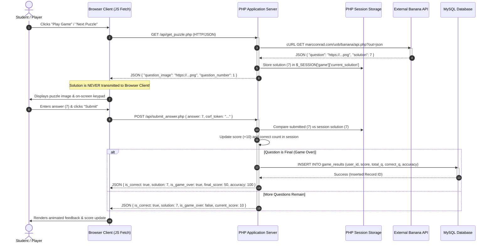

# Distributed System Architecture Documentation
**Course:** CIS046-3 Software For Enterprise  
**Project:** Banana Quiz Game – Distributed Web Application  
**Author:** University Student (Assisted by AI Pair-Programming)  

---

## 1. Architectural Overview

The **Banana Quiz Game** is implemented as a **distributed multi-tier client-server architecture**. In software engineering, a distributed system is defined as a collection of autonomous computing entities that communicate over a network to achieve a common objective. 

This project distributes responsibilities across four distinct nodes:
1. **Frontend Client Tier:** Modern Web Browser (HTML5, CSS3, Vanilla JavaScript, Fetch API).
2. **Application Server Tier:** Web and PHP 8+ Application Server (XAMPP Apache / PHP runtime).
3. **Enterprise Persistence Tier:** Relational Database Server (MySQL / MariaDB).
4. **External Web Service Tier:** Marc Conrad's Banana API (`https://marcconrad.com/uob/banana/api.php`).

```
+-----------------------------------------------------------------------------------+
|                            DISTRIBUTED SYSTEM TOPOLOGY                            |
+-----------------------------------------------------------------------------------+

   [ Browser Client ]
          |
          | (1) Asynchronous HTTPS/REST + JSON (Fetch API)
          v
   [ PHP 8+ Application Server (Apache) ] <-----> (3) Session Storage (Server-Side RAM)
     |                                |
     | (2) cURL HTTP/REST (JSON)      | (4) TCP/IP MySQL Protocol (PDO Prepared Stmts)
     v                                v
[ External Banana API ]      [ MySQL Relational DB ]
(marcconrad.com Cloud)       (Users & Game Results)
```

---

## 2. Distinction: Distributed Multi-Tier vs. Microservices

> **Academic Clarification:**  
> This project is explicitly designed as a **distributed multi-tier client-server application**, **not** a microservices architecture.
> - A **microservices architecture** decomposes business capabilities into dozens of independently deployable, loosely coupled containerized services (e.g. Docker, Kubernetes, gRPC, service mesh), each with its own decentralized database.
> - A **distributed multi-tier architecture** separates presentation, application logic, persistence, and external third-party web services across discrete networked machines. It provides robust enterprise separation of concerns, high security, and clear failure domains without the operational overhead of microservice container orchestrators.

---

## 3. Communication Protocols and Data Flow

### Sequence Diagram: Quiz Round Workflow



---

## 4. Tier Responsibilities & Component Details

### A. Frontend Presentation Tier
- **Technologies:** HTML5 Semantic Markup, Responsive CSS3 (Custom styling, Flexbox, Grid), Modern JavaScript (ES6+).
- **Communication:** Sends asynchronous `GET` and `POST` requests via the native **Fetch API**.
- **Role:** Handles user interaction events (keypad clicks, keyboard input, button triggers), renders puzzle images dynamically, provides instant feedback, and updates the DOM without full page refreshes.

### B. Application Server Tier (PHP 8+)
- **Technologies:** PHP 8.1+, Apache Web Server (XAMPP).
- **Security Gatekeeper:**
  - Manages authenticated sessions (`init_session()`, `session_regenerate_id()`).
  - Enforces Cross-Site Request Forgery (CSRF) tokens.
  - Sanitizes user input and escapes HTML output (`htmlspecialchars()`).
  - Holds the secret quiz solution in server RAM (`$_SESSION['game']['current_solution']`).
- **External Proxy (cURL):**
  - Acts as an interoperable bridge to Marc Conrad's Banana API.
  - Uses cURL with strict timeouts (`CURLOPT_TIMEOUT => 8`) and SSL error handling.
  - Shields the browser from cross-origin restrictions (CORS) and prevents exposure of API credentials or solutions.

### C. Enterprise Persistence Tier (MySQL)
- **Engine:** InnoDB storage engine with UTF-8 (`utf8mb4_unicode_ci`) character encoding.
- **Relational Integrity:** Foreign key constraints with `ON DELETE CASCADE` ensuring referential integrity between `users` and `game_results`.
- **Performance:** B-Tree indexing on `users.email`, `users.username`, and `game_results.user_id`.
- **Query Abstraction:** Communicates exclusively via PHP Data Objects (PDO) with prepared statements (`PDO::ATTR_EMULATE_PREPARES => false`) to eliminate SQL injection vulnerabilities.

### D. External Cloud Web Service Tier (Banana API)
- **Host:** Marc Conrad's University of Bedfordshire API (`marcconrad.com`).
- **Endpoint:** `https://marcconrad.com/uob/banana/api.php?out=json`.
- **Output:** Dynamic mathematical picture puzzles encoded in PNG format and accompanying integer solution digits.

---

## 5. Security Architecture & Boundary Isolation

1. **Answer Masking:** The raw solution integer returned by the external Banana API is stored solely inside the server-side session. It is completely omitted from the JSON payload returned to the browser client during gameplay.
2. **Zero Client Trust:** The client browser never submits scores or accuracy calculations. All points, streaks, and round tallies are computed exclusively on the PHP server.
3. **Session Fixation Defense:** Following authentication in `auth/login.php` and `auth/register.php`, `session_regenerate_id(true)` invalidates old session identifiers.
4. **CSRF Mitigation:** Every sensitive state mutation requires a cryptographic 32-byte token validated via `hash_equals()`.
5. **Data Segregation:** SQL queries for dashboard metrics and game history strictly filter by the authenticated user's ID (`WHERE user_id = :uid`), preventing horizontal privilege escalation.
